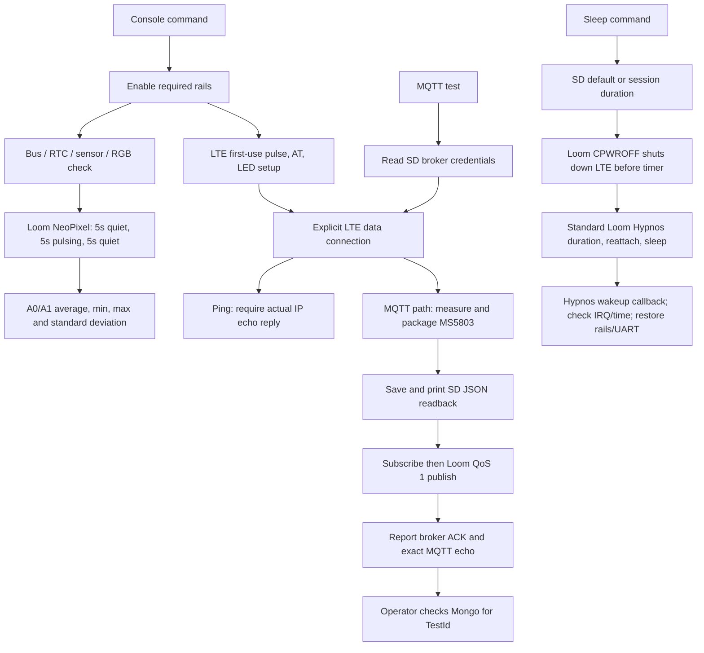

# Bench implementation map

Exact source anchors for the current code and delegated SDK behavior.

| Feature | Source | Anchor |
| --- | --- | --- |
| Automatic power | [Bringup.cpp:90](C:/Users/brews/Documents/Arduino/Loomified_LTE_R5_debug_passthrough/Bringup.cpp:90) | `static bool ready(Check check) {` |
| First-use LTE readiness / conditional pulse | [Bringup.cpp:509](C:/Users/brews/Documents/Arduino/Loomified_LTE_R5_debug_passthrough/Bringup.cpp:509) | `static bool lteOpen() {` |
| Power waveform / LEDs | [NetworkBench.h:13](C:/Users/brews/Documents/Arduino/Loomified_LTE_R5_debug_passthrough/NetworkBench.h:13) | `static void ltePulse() {` |
| Stored LED configuration | [NetworkBench.h:23](C:/Users/brews/Documents/Arduino/Loomified_LTE_R5_debug_passthrough/NetworkBench.h:23) | `static bool configureLteLeds() {` |
| RTC compile fallback | [Bringup.cpp:285](C:/Users/brews/Documents/Arduino/Loomified_LTE_R5_debug_passthrough/Bringup.cpp:285) | `static bool ensureRtc() {` |
| SD/default sleep settings | [StorageBench.h:17](C:/Users/brews/Documents/Arduino/Loomified_LTE_R5_debug_passthrough/StorageBench.h:17) | `static bool loadSleepConfig(const char *path) {` |
| Sleep duration and overrides | [CommandsBench.h:2](C:/Users/brews/Documents/Arduino/Loomified_LTE_R5_debug_passthrough/CommandsBench.h:2) | `static void sleepCommand(` |
| Standby and timed wake | [Bringup.cpp:426](C:/Users/brews/Documents/Arduino/Loomified_LTE_R5_debug_passthrough/Bringup.cpp:426) | `static void sleepTest(uint32_t seconds,uint8_t cycles) {` |
| Real sensor package | [Bringup.cpp:182](C:/Users/brews/Documents/Arduino/Loomified_LTE_R5_debug_passthrough/Bringup.cpp:182) | `static bool ms5803Test(uint8_t requested=0,bool makePacket=false) {` |
| Retained JSON and readback | [StorageBench.h:96](C:/Users/brews/Documents/Arduino/Loomified_LTE_R5_debug_passthrough/StorageBench.h:96) | `static bool saveSampleFile(bool acquire=true) {` |
| SD directory listing | [StorageBench.h:112](C:/Users/brews/Documents/Arduino/Loomified_LTE_R5_debug_passthrough/StorageBench.h:112) | `static bool listSdFiles(char *latest=nullptr) {` |
| LTE data session | [NetworkBench.h:46](C:/Users/brews/Documents/Arduino/Loomified_LTE_R5_debug_passthrough/NetworkBench.h:46) | `static bool connectData() {` |
| Internet echo reply | [NetworkBench.h:64](C:/Users/brews/Documents/Arduino/Loomified_LTE_R5_debug_passthrough/NetworkBench.h:64) | `static void ltePing(const char *host) {` |
| MQTT broker / readback / manual Mongo | [NetworkBench.h:100](C:/Users/brews/Documents/Arduino/Loomified_LTE_R5_debug_passthrough/NetworkBench.h:100) | `static void mqttTest() {` |
| RGB and ADC comparison | [PixelBench.h:58](C:/Users/brews/Documents/Arduino/Loomified_LTE_R5_debug_passthrough/PixelBench.h:58) | `static void rgbNoiseTest() {` |
| SDK NeoPixel routing | [Loom_Neopixel.cpp:89](C:/Users/brews/AppData/Local/Arduino15/packages/loom4/hardware/samd/4.9/libraries/Loom/src/Hardware/Actuators/Loom_Neopixel/Loom_Neopixel.cpp:89) | `bool Loom_Neopixel::configure_port(` |
| SDK staged NeoPixel transmission | [Loom_Neopixel.cpp:98](C:/Users/brews/AppData/Local/Arduino15/packages/loom4/hardware/samd/4.9/libraries/Loom/src/Hardware/Actuators/Loom_Neopixel/Loom_Neopixel.cpp:98) | `void Loom_Neopixel::show(uint8_t port) {` |
| Normal packet schema | [Loom_Manager.cpp:110](C:/Users/brews/AppData/Local/Arduino15/packages/loom4/hardware/samd/4.9/libraries/Loom/src/Loom_Manager.cpp:110) | `void Manager::package() {` |
| SDK awake-modem adoption | [Loom_LTE.cpp:604](C:/Users/brews/AppData/Local/Arduino15/packages/loom4/hardware/samd/4.9/libraries/Loom/src/Internet/Connectivity/Loom_LTE/Loom_LTE.cpp:604) | `bool Loom_LTE::initializeFromAwake() {` |
| SDK externally awakened LTE shutdown | [Loom_LTE.cpp:617](C:/Users/brews/AppData/Local/Arduino15/packages/loom4/hardware/samd/4.9/libraries/Loom/src/Internet/Connectivity/Loom_LTE/Loom_LTE.cpp:617) | `bool Loom_LTE::shutdownForSleep() {` |
| Packet owns temporary sensor labels | [Loom_Manager.cpp:171](C:/Users/brews/AppData/Local/Arduino15/packages/loom4/hardware/samd/4.9/libraries/Loom/src/Loom_Manager.cpp:171) | `moduleEntry["module"] = const_cast<char *>(safeModuleName);` |
| SDK R5 internal data profile | [Loom_LTE_SaraR5Data.h:21](C:/Users/brews/AppData/Local/Arduino15/packages/loom4/hardware/samd/4.9/libraries/Loom/src/Internet/Connectivity/Loom_LTE/Loom_LTE_SaraR5Data.h:21) | `const char *loomSaraR5OpenData(` |
| SDK ordinary Hypnos sleep | [Loom_Hypnos.cpp:1125](C:/Users/brews/AppData/Local/Arduino15/packages/loom4/hardware/samd/4.9/libraries/Loom/src/Hardware/Loom_Hypnos/Loom_Hypnos.cpp:1125) | `void Loom_Hypnos::sleep(bool waitForSerial)` |
| SDK Hypnos standby implementation | [Loom_Hypnos.cpp:1201](C:/Users/brews/AppData/Local/Arduino15/packages/loom4/hardware/samd/4.9/libraries/Loom/src/Hardware/Loom_Hypnos/Loom_Hypnos.cpp:1201) | `bool Loom_Hypnos::sleepImpl(bool waitForSerial, bool wakeModules) {` |
| SDK topic / publish | [Loom_MongoDB.cpp:114](C:/Users/brews/AppData/Local/Arduino15/packages/loom4/hardware/samd/4.9/libraries/Loom/src/Internet/Logging/Loom_MongoDB/Loom_MongoDB.cpp:114) | `bool Loom_MongoDB::publish() {` |
| SDK broker acknowledgement | [MQTTComponent.cpp:249](C:/Users/brews/AppData/Local/Arduino15/packages/loom4/hardware/samd/4.9/libraries/Loom/src/Internet/Logging/MQTTComponent/MQTTComponent.cpp:249) | `bool MQTTComponent::finishPublish() {` |

The data-connection helper is shared by ping and MQTT; it does not itself
publish. Only the MQTT command continues into the sample/save/publish branch.
Mongo insert verification is a manual step as requested. The offline service
mock is not used by these commands.
